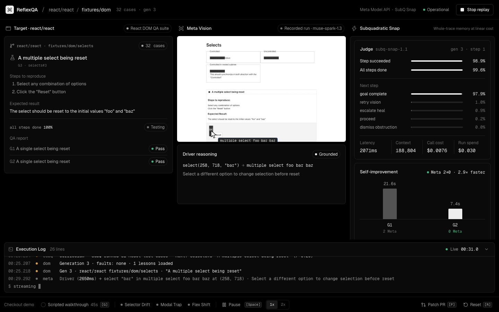

# ReflexQA

**A recursive self-improving GUI QA agent, pointed at Meta's largest open-source project.**



▶ **[Watch the 1-minute demo](demo/reflexqa-demo.mp4)**: a real recorded run, captioned. · 

React keeps a manual browser QA suite in [`react/react` › `fixtures/dom`](https://github.com/react/react/tree/main/fixtures/dom): dozens of test cases with "Steps to reproduce" and an "Expected Result". Maintainers click through them by hand. ReflexQA runs them autonomously:

- **Meta Muse Spark (Meta Model API) is the Driver.** It reads each test case off the screen, looks at the screenshot, and clicks, types, picks options and presses keys in a real Chromium browser.
- **SubQ Snap (Subquadratic) is the Judge, Router and Memory.** After every action, one decision call reads **~189K tokens of React DOM's real source** (`react-dom-bindings` client and event system, plus the fixtures), the agent's whole memory and past trajectories, and before/after screenshots. It returns calibrated probabilities: *did the step work?*, *are all steps done?*, *does the Expected Result hold?*, and *what next?* It also writes the curriculum by ranking every untested React case.
- **It improves itself.** Each passing trajectory becomes a skill, replayed later with **zero Meta calls** and still verified step by step by SubQ. When the Judge rejects a replayed step, control goes back to Meta. After each run, Meta reflects and writes a lesson that later runs use, plus a Playwright test that automates the manual case.

## Results (real runs, recorded in [`demo/react-run.json`](demo/react-run.json))

| Gen | React test case (fixtures/dom) | Chosen by | Meta calls | Steps | Time | SubQ verdict |
|---|---|---|---|---|---|---|
| 1 | A single select being reset | seed | 2 | 2 | 21.6s | **PASS** (P=0.98) |
| 2 | A single select being reset | memory replay | **0** | 2 | **7.4s** | **PASS** (P=0.99) |
| 3 | A multiple select being reset | SubQ, from 31 untested cases | 2 | 2 | 24.0s | **PASS** (P=0.98) |

- **Meta:** 6 calls for the whole campaign (4 Driver actions + 2 reflections). Gen 2 needed none.
- **SubQ per judgement:** ~188,600 input tokens, **2.1–2.9s**, **$0.0075**. The whole 3-generation campaign cost **$0.045** in SubQ.
- **SubQ accuracy:** on the fault-injected checkout suite, the Judge's "goal reached" verdict matched DOM ground truth on **7/7** steps. Scripted probes: a click blocked by a modal scored *progressed* 0.007, and the confirmation scored *goal* 0.999.
- **Meta Driver:** ~2.2–4.7s per decision with set-of-marks grounding.

## Architecture

```
            ┌───────────── curriculum: SubQ ranks untested React cases ─────────────┐
            ▼                                                                        │
  react/react fixtures/dom ──► /react-qa?fixture=…&case=N (real page, real React DOM)
            │                                                                        │
            ▼                                                                        │
  Playwright (headless Chromium) ── screenshot + numbered marks ──► Meta Muse Spark   │
            ▲                                                      (Driver: action)  │
            │ click / type / select / key                                │           │
            └────────────────────────────────────────────────────────────┘           │
            │ before/after frames, control values, console, trajectory               │
            ▼                                                                        │
  SubQ Snap (Judge): React DOM source (~189K tok) + memory + traces + 2 frames ──────┤
     progressed? · steps complete? · expected holds? · route next                    │
            │                                                                        │
            ▼                                                                        │
  Memory: skills (zero-Meta replays) · lessons (Meta reflection) · full traces ──────┘
```

| Path | What |
|---|---|
| `lib/engine/reactSuite.ts` | React campaign: catalog discovery, Driver actions, Judge, curriculum, reflection |
| `lib/engine/meta.ts` | Meta Model API client (`muse-spark-1.3`, OpenAI-compatible) |
| `lib/engine/subq.ts` | SubQ Decisions API client (`subq-snap-1.1`, `/v1/systemone`) |
| `lib/engine/loop.ts` | Second suite: a checkout with injected faults (selector drift, modal trap, flex shift) and DOM ground truth |
| `app/api/run/route.ts` | Streams a campaign over SSE and records it. `?replay=1` replays the last real run |
| `app/react-qa/` | Hosts the vendored React fixtures one test case at a time |
| `vendor/` | `react/react` @ `d71b537`: `fixtures/dom` and `react-dom-bindings` client and events source (MIT) |

## Run it

```bash
npm install
npx playwright install chromium
```

Add `MODEL_API_KEY` (Meta Model API) and `SUBQ_API_KEY` (SubQ) to `.env.local`, then:

```bash
npm run dev
```

Open http://localhost:3000.
- **Run live** (`L`) runs 3 generations on React's suite (≈6 Meta calls, ≈$0.05 SubQ).
- **Replay run** streams the recorded real run with no API keys.
- **Scripted walkthrough** (bottom toolbar, `G`) is the original 45s choreographed checkout demo.

API: `GET /api/run?suite=react|checkout&generations=3&fresh=1` · `GET /api/run?replay=1`.

## Honest notes

- The Driver clicks the centre of a numbered mark (set-of-marks grounding). Meta's raw pixel coordinates landed off-target in our first test, while its choice of element was right.
- Native `<select>` popups don't render in headless Chromium, so the Driver has a `select` action. That's an assumption about the browser, not about React.
- The fixtures run on this app's React 18.3 through legacy `ReactDOM.render`, exactly as `fixtures/dom` does. The deprecation warning is filtered out of the console signal.
- Meta's generated Playwright tests are model output and are not auto-verified yet. In the recorded run, the multi-select test asserts the wrong reset value.
